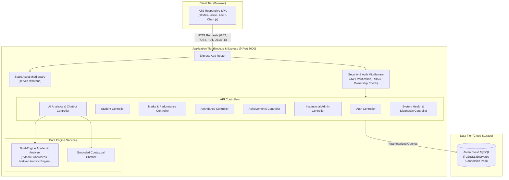
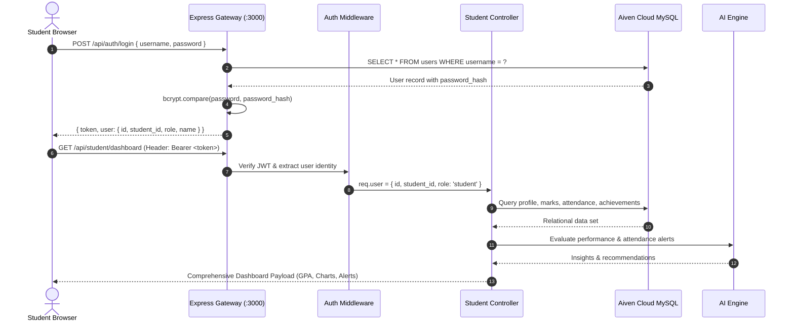

# ATS System Architecture & Unified Design Specification

**System:** Academic Progress and Achievement Tracking System (ATS)  
**Standard Origin:** `http://localhost:3000`  
**Database Authority:** Aiven Cloud MySQL  
**Runtime:** Node.js (v24.x) + Express 5  

---

## 1. Architectural Overview

The ATS architecture is structured around a single-origin, layered model that unifies frontend delivery, RESTful application programming interfaces, cloud persistence, and an intelligent academic analytics subsystem.



---

## 2. Core Architectural Principles

1. **Unified Origin:**
   - The Express application serves both the static web pages (`/frontend`) and the JSON REST APIs (`/api/*`) on port 3000.
   - Eliminates cross-origin resource sharing (CORS) complications in production while providing an integrated developer experience.

2. **Authoritative Persistence (No Silent Mock Fallback):**
   - Aiven Cloud MySQL is the authoritative single source of truth.
   - When the database is unreachable or unconfigured, the system returns explicit, structured 503 Service Unavailable responses and displays actionable diagnostic statuses on `/api/health`.
   - Mock data is never silently presented as real college records.

3. **Zero-Trust Student Isolation:**
   - Every protected route enforces JWT cryptographic signature verification.
   - Student users can only query and mutate their own profile, marks, attendance, and AI assessments.
   - Administrative and faculty privileges are guarded by strict role-based access control (RBAC).

4. **Resilient Dual-Mode AI Integration:**
   - The AI analysis subsystem includes a modular Python analyzer (`ai/academic_analyzer.py`) for environments with an active Python runtime.
   - A parallel high-precision native Node.js heuristic engine executes the identical mathematical rules if Python is missing, ensuring zero downtime on any deployment target.

5. **Defense in Depth Security:**
   - 100% Parameterized SQL statements using `mysql2/promise` to prevent SQL Injection.
   - Passwords hashed using `bcryptjs` with salt rounds = 10.
   - No sensitive secrets (tokens, DB passwords, connection URIs) are exposed in API payloads, logs, or diagnostic endpoints.

---

## 3. End-to-End Request Lifecycles

### 3.1 Student Authentication & Dashboard Loading



---

## 4. Directory Structure

```
APAATS MINI/
├── backend/
│   ├── config/
│   │   └── db.js                 # Centralized Aiven MySQL connection pool
│   ├── middleware/
│   │   ├── authMiddleware.js     # JWT verification, RBAC, ownership guards
│   │   └── errorHandler.js       # Centralized error handler without stack leak
│   ├── controllers/
│   │   ├── authController.js     # Login, registration, me, logout
│   │   ├── studentController.js  # Student profile & aggregated dashboard
│   │   ├── marksController.js    # Marks by semester/subject, CGPA calc
│   │   ├── attendanceController.js # Subject-wise & aggregate attendance
│   │   ├── achievementsController.js # Student achievements CRUD
│   │   ├── adminController.js    # Multi-student stats, at-risk alerts
│   │   ├── aiController.js       # Academic analysis & chatbot endpoints
│   │   └── healthController.js   # Diagnostic healthcheck
│   ├── routes/
│   │   ├── authRoutes.js
│   │   ├── studentRoutes.js
│   │   ├── marksRoutes.js
│   │   ├── attendanceRoutes.js
│   │   ├── achievementsRoutes.js
│   │   ├── adminRoutes.js
│   │   ├── aiRoutes.js
│   │   └── healthRoutes.js
│   ├── services/
│   │   ├── aiService.js          # Dual-engine analytics (Python / Native)
│   │   └── chatService.js        # Grounded academic conversational engine
│   └── server.js                 # Application entry point & static server
├── frontend/
│   ├── index.html                # Unified ATS student/admin dashboard UI
│   ├── login.html                # Dedicated secure login portal
│   ├── style.css                 # Poppins typography, modern responsive design
│   ├── script.js                 # Dynamic API client, Chart.js, chatbot logic
│   └── assets/                   # Logos, icons, and profile media
├── database/
│   ├── schema.sql                # Authoritative DDL (9 normalized tables)
│   ├── college_data.sql          # Idempotent seed data (departments, courses, demo users)
│   └── migrate.js                # Migration runner for Aiven Cloud MySQL
├── ai/
│   ├── academic_analyzer.py      # Standalone Python statistical analyzer
│   └── requirements.txt          # Python dependencies (if Python is enabled)
├── docs/                         # Formal project deliverables & guides
│   ├── PROJECT_AUDIT.md
│   ├── ARCHITECTURE.md
│   ├── API_INVENTORY.md
│   ├── DATABASE_AUDIT.md
│   ├── IMPLEMENTATION_PLAN.md
│   ├── TEST_REPORT.md
│   └── SETUP_GUIDE.md
├── tests/
│   └── api.test.js               # Comprehensive automated verification suite
├── .env.example                  # Template with safe placeholders
├── package.json                  # Application dependencies and npm scripts
└── README.md                     # High-level overview
```

---

*End of Architecture Specification.*
