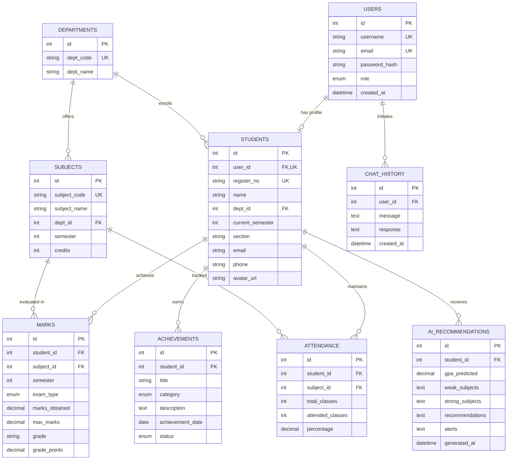

# ATS Database Architecture & Cloud Compatibility Audit

**Target Persistence:** Aiven Cloud MySQL  
**Target Database Names:** Supports both `defaultdb` (Aiven standard default) and custom `ats_database`  
**Driver:** `mysql2` with Promise Pool  
**SSL/TLS:** Required (`rejectUnauthorized: false` or managed CA certificate)  

---

## 1. Relational Schema Architecture (3NF)

The database schema is designed to 3rd Normal Form (3NF) to support enterprise academic operations, audit logging, and role-based permissions.



---

## 2. Aiven Cloud MySQL Compatibility Assessment

| Criterion | Requirement | Implementation Strategy |
|---|---|---|
| **Database Permissions** | In Aiven shared setups, standard accounts often lack `CREATE DATABASE` privilege. | All SQL scripts execute within the active connection database context (`defaultdb` or user-defined `ats_database`) without hardcoding `CREATE DATABASE` or `USE ...;`. |
| **TLS/SSL Encryption** | Aiven mandates TLS 1.2+ encrypted connections. | `backend/config/db.js` configures SSL with `rejectUnauthorized: false` by default or reads optional CA bundle from `DB_SSL_CA`. |
| **Connection Limits** | Aiven tiers enforce strict maximum concurrent connections. | Connection pooling (`connectionLimit: 10`, `waitForConnections: true`, `queueLimit: 0`, `idleTimeout: 60000`) prevents socket exhaustion. |
| **Idempotence & Safety** | Never wipe existing records or drop live tables. | All DDL uses `CREATE TABLE IF NOT EXISTS` and all migrations use non-destructive `INSERT IGNORE` or `ON DUPLICATE KEY UPDATE`. |

---

## 3. Academic Calculation Rules & Grading System

### Credit-Weighted Cumulative Grade Point Average (CGPA)
The system calculates GPA and CGPA using credit weights according to standardized university regulations rather than an unweighted marks average:

$$\text{GPA} = \frac{\sum_{i=1}^{n} (\text{Grade Points}_i \times \text{Credits}_i)}{\sum_{i=1}^{n} \text{Credits}_i}$$

### Standard 10-Point Grading Scale:
- Marks $\ge 90$: Grade **O** (Outstanding) $\rightarrow$ 10.0 Points
- Marks $80 - 89$: Grade **A+** (Excellent) $\rightarrow$ 9.0 Points
- Marks $70 - 79$: Grade **A** (Very Good) $\rightarrow$ 8.0 Points
- Marks $60 - 69$: Grade **B+** (Good) $\rightarrow$ 7.0 Points
- Marks $50 - 59$: Grade **B** (Above Average) $\rightarrow$ 6.0 Points
- Marks $45 - 49$: Grade **C** (Average) $\rightarrow$ 5.0 Points
- Marks $< 45$: Grade **F** (Fail) $\rightarrow$ 0.0 Points

### Attendance Thresholds:
- **Eligible:** $\ge 75\%$
- **At-Risk Warning:** $65\% - 74.9\%$
- **Condonation / Ineligible:** $< 65\%$

---

## 4. Verification Queries

Each table can be verified with non-destructive verification queries:

```sql
-- 1. Verify Users & Roles
SELECT role, COUNT(*) AS count FROM users GROUP BY role;

-- 2. Verify Enrolled Students
SELECT s.register_no, s.name, d.dept_code, s.current_semester 
FROM students s 
JOIN departments d ON s.dept_id = d.id;

-- 3. Verify Credit-Weighted GPA
SELECT 
    s.name, 
    ROUND(SUM(m.grade_points * sub.credits) / SUM(sub.credits), 2) AS calculated_gpa
FROM marks m
JOIN students s ON m.student_id = s.id
JOIN subjects sub ON m.subject_id = sub.id
GROUP BY s.id, s.name;

-- 4. Verify Aggregate Attendance
SELECT 
    s.name,
    ROUND(SUM(a.attended_classes) * 100.0 / SUM(a.total_classes), 1) AS overall_attendance_pct
FROM attendance a
JOIN students s ON a.student_id = s.id
GROUP BY s.id, s.name;
```

---

*End of Database Audit Specification.*
