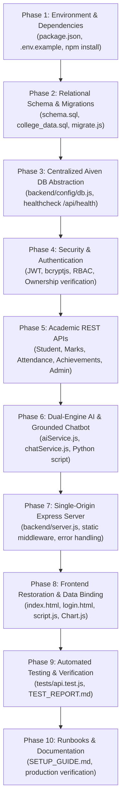

# ATS Phased Implementation & Engineering Roadmap

**Project:** Academic Progress and Achievement Tracking System (ATS)  
**Execution Strategy:** Incremental, Non-Destructive, Test-Driven Verification  

---

## 1. Phase Breakdown & Execution Sequence

---

## 2. Phase-by-Phase Deliverables & Verification Criteria

### Phase 1: Environment & Dependencies
- **Actions:**
  - Build `package.json` with required production dependencies (`express`, `mysql2`, `cors`, `dotenv`, `jsonwebtoken`, `bcryptjs`).
  - Create comprehensive `.env.example` with safe dummy placeholders.
  - Install dependencies cleanly into workspace `node_modules`.
- **Verification:** Run `npm list --depth=0` without missing dependencies.

### Phase 2: Relational Schema & Safe Migration
- **Actions:**
  - Create `database/schema.sql` (9 tables, 3NF, foreign keys, cascade safety).
  - Create `database/college_data.sql` with idempotent seed records.
  - Create `database/migrate.js` migration runner supporting `defaultdb` and custom databases.
- **Verification:** Run migration script in test mode; verify syntax and schema compatibility.

### Phase 3: Centralized Aiven DB Abstraction
- **Actions:**
  - Implement `backend/config/db.js` with `mysql2/promise` connection pooling, TLS/SSL configuration, retry logic, and zero silent fallback to mock data.
  - Implement `GET /api/health` reporting database connection diagnostic states without revealing secrets.
- **Verification:** Test health endpoint with active DB and simulated connection states.

### Phase 4: Security & Authentication
- **Actions:**
  - Build `backend/middleware/authMiddleware.js` (`verifyToken`, `requireRole`, `verifyStudentOwnership`).
  - Build `backend/controllers/authController.js` with `bcryptjs` (hash comparison) and JWT tokens.
  - Build `backend/routes/authRoutes.js`.
- **Verification:** Verify valid login returns token; verify invalid login returns 401; verify protected routes block unauthenticated requests.

### Phase 5: Academic REST APIs
- **Actions:**
  - Implement Student Profile & Dashboard API (`/api/student/dashboard`).
  - Implement Marks & CGPA API with credit-weighted formula (`/api/marks`).
  - Implement Attendance calculation API with at-risk warnings (`/api/attendance`).
  - Implement Achievements CRUD API (`/api/achievements`).
  - Implement Administrative Institutional Analytics (`/api/admin/overview`, `/api/admin/at-risk`).
- **Verification:** Execute curl / fetch tests against each endpoint verifying JSON responses and status codes.

### Phase 6: Dual-Engine AI & Grounded Chatbot
- **Actions:**
  - Create standalone Python script `ai/academic_analyzer.py` for environments with Python.
  - Implement dual-engine service in `backend/services/aiService.js` (auto-detects Python; uses native Node.js heuristic engine when Python is absent).
  - Implement contextual academic chatbot `backend/services/chatService.js` that answers queries grounded in student database facts.
- **Verification:** Run AI analysis endpoint; verify identical mathematical calculations between engines; verify chatbot responds with student attendance and marks facts without leaking cross-student data.

### Phase 7: Single-Origin Express Server
- **Actions:**
  - Unify frontend and backend in `backend/server.js` listening on port 3000.
  - Serve static frontend from `/frontend` directory.
  - Provide fallback to `index.html` for single-page routing.
  - Centralize error handling middleware preventing stack trace leakage.
- **Verification:** Start server; verify `http://localhost:3000` loads dashboard and `http://localhost:3000/api/health` responds.

### Phase 8: Frontend Restoration & Data Binding
- **Actions:**
  - Connect recovered modern UI in `frontend/index.html` to live API endpoints.
  - Add `frontend/login.html` for student and administrator authentication.
  - Integrate Chart.js in `frontend/script.js` to render interactive Academic Performance Bar Chart and Attendance Donut Chart.
  - Populate dynamic GPA, Attendance percentage, Achievements count, and AI recommendations.
  - Add interactive Chatbot drawer/widget.
  - Add navigation between Dashboard, Student Profile, Subjects, Reports, and AI Analysis views.
- **Verification:** Load UI, log in, view live charts, and interact with chatbot.

### Phase 9: Automated Testing & Verification
- **Actions:**
  - Implement automated test suite in `tests/api.test.js`.
  - Validate: server boot, health checks, authentication, authorization, ownership isolation, academic calculations, AI analysis, chatbot, and error handling.
  - Record findings in `docs/TEST_REPORT.md`.
- **Verification:** Execute `npm test` and verify test suite passes.

### Phase 10: Runbooks & Documentation
- **Actions:**
  - Author comprehensive `docs/SETUP_GUIDE.md` detailing step-by-step onboarding for Aiven MySQL, local execution, and cloud deployment.
  - Deliver final status report to user.
- **Verification:** Review documentation against acceptance criteria.

---

*End of Implementation Plan.*
